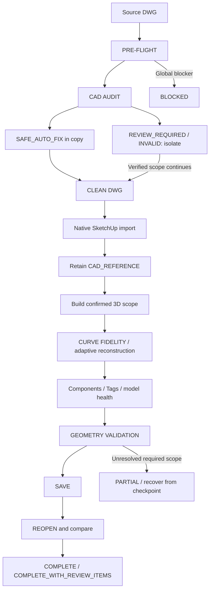

# sketchup-from-cad-landscape

[简体中文](README.zh-CN.md)

A Codex Skill for reliable landscape architecture CAD-to-SketchUp workflows.
Tested workflow for landscape CAD-to-SketchUp automation with explicit validation and failure handling. Every new DWG still requires pre-flight checks.

## Quick Install - Windows

**v1.1: Windows installation & environment-check update. No Git required.** For landscape students and designers who want to install the workflow before configuring desktop automation.

1. Choose **Code -> Download ZIP** on GitHub, or [download the main ZIP](https://github.com/lunxianle666/sketchup-from-cad-landscape/archive/refs/heads/main.zip).
2. Extract the complete ZIP and open the folder containing `install.ps1`.
3. Open PowerShell in that folder and run:

   ```powershell
   powershell.exe -NoProfile -ExecutionPolicy Bypass -File .\install.ps1
   ```
4. The installer automatically runs the environment checker. Run it again after adding dependencies:

   ```powershell
   powershell.exe -NoProfile -ExecutionPolicy Bypass -File .\check-environment.ps1
   ```
5. Follow **Missing / Action Required**, then invoke the Skill in Codex.

No administrator permissions or permanent execution-policy changes are needed. **SKILL INSTALLED does not mean FULL AUTOMATION READY.** The installer copies only the Skill and its two referenced runtime documents. Different existing installs are preserved in a timestamped backup outside the Skills discovery directory.

See [Quick Start](docs/QUICK_START.md), [中文小白教程](docs/QUICK_START.zh-CN.md), and [Troubleshooting](docs/TROUBLESHOOTING.md).

## What It Is

An instruction-only workflow Skill that coordinates existing AutoCAD automation and a SketchUp MCP bridge. It is not a SketchUp MCP server, AutoCAD plugin, or geometry engine. Installing it does not install or configure those tools. The operational [SKILL.md](SKILL.md) is in Chinese; this English guide explains setup and use.

## Why It Exists

DWG imports can preserve vertices while approximating continuous curves, omit short edges and annotations, and leave design intent unresolved. This Skill makes those limitations explicit, protects the source drawing, and checks the resulting model against CAD evidence.

## Features

- Pre-flight decisions: `READY`, `READY_WITH_REVIEW`, or `BLOCKED`.
- Read-only RAW protection, separate CLEAN DWG, and entity-level audit trails.
- `SAFE_AUTO_FIX`, `REVIEW_REQUIRED`, `INVALID`, and `STOP GUESSING` handling.
- Native DWG import with retained `CAD_REFERENCE` and CAD as the XY source of truth.
- Adaptive curve reconstruction from original CAD parameters in MODEL only.
- BlockReference → reusable components, instance transforms, Groups, and Tags.
- Model health, overlay and geometry checks, checkpoints, and failure recovery.
- Actual save/reopen verification and honest completion states.

## Workflow



Local ambiguity does not stop unrelated, verified work. Global blockers stop further modeling; failed operations resume from a verified checkpoint.

## Two dependency levels

**Level 1:** Installing the Skill only needs Windows and Codex with Skills support. Missing CAD, Python or MCP tools do not block file installation.

**Level 2:** Running the complete workflow needs the desktop automation dependencies below and live PRE-FLIGHT.

| Component | Install Skill | Full Automation |
| --- | --- | --- |
| Windows + Codex Skills | Required | Required |
| Git | Optional | Optional |
| AutoCAD desktop / COM | No | Required |
| Python | No | Required |
| pywin32 | No | Required |
| SketchUp desktop / DWG importer | No | Required |
| Compatible SketchUp MCP bridge | No | Required |
| AutoCAD entity-audit workflow | No | Required |

## Requirements

Required or expected for this workflow:

- OpenAI Codex with local Skills support and access to the desktop automation tools.
- Windows and a licensed AutoCAD desktop installation with COM automation support.
- Python and `pywin32`, with process permissions matching AutoCAD.
- SketchUp desktop with a working native DWG importer; verify availability for your edition.
- A SketchUp MCP bridge exposing instance/model inspection and authorized Ruby API execution. The tested bridge is Ringo-Sketchup-MCP; its Node/runtime requirements are managed upstream.
- An AutoCAD automation workflow/skill able to audit actual entities, curve parameters, blocks, and transforms. The historical setup used `autocad-dwg-redraw`; it is not bundled here.

Provide units, source/output locations, scope, and authoritative heights/design rules. Missing critical parameters require review.

## Tested Environment

Windows, AutoCAD 2025, Python 3.12.10 + pywin32, SketchUp 2023 (23.0.367), Ruby 2.7.2, Ringo-Sketchup-MCP 1.3.2, and Codex CLI were tested locally on 2026-09-17. The setup included a local MCP schema compatibility adjustment and temporary Ruby enablement. See [tested environment and results](docs/TESTED_ENVIRONMENT.md).

Other AutoCAD, SketchUp, bridge, and client versions are potentially compatible but untested here. Neither the exact tested versions nor other combinations skip PRE-FLIGHT.

## Installation

### Method A - Download ZIP (recommended)

Use the [Quick Install](#quick-install---windows) steps. **Git is optional** and no third-party dependency is needed to copy the Skill files. Downloading/extracting the full package is required; running inside ZIP or downloading only `install.ps1` is insufficient.

### Method B - Git clone (developers)

Only if Git is already installed:

```powershell
git clone https://github.com/lunxianle666/sketchup-from-cad-landscape.git
cd sketchup-from-cad-landscape
powershell.exe -NoProfile -ExecutionPolicy Bypass -File .\install.ps1
```

The installer defaults to `~/.agents/skills/sketchup-from-cad-landscape`, the current user location in [official OpenAI documentation](https://learn.chatgpt.com/docs/build-skills). Repository-level `.agents/skills` can also be selected:

```powershell
powershell.exe -NoProfile -ExecutionPolicy Bypass -File .\install.ps1 -SkillsDirectory .\.agents\skills
```

The installer does not change legacy `~/.codex/skills` by default. If a legacy copy already works, confirm discovery in Codex and avoid creating duplicate copies. An explicit `-SkillsDirectory` selects the exact target to install/check. Only use it for a directory you intend to update. Existing different content is moved intact to `skill-install-backups` beside the selected Skills directory, then replaced with the verified public runtime files; identical content is left alone. Linked targets are refused. Failed replacements attempt to restore the original without deleting files.

`SKILL.md` references `docs/TESTED_ENVIRONMENT.md` and `docs/LIMITATIONS.md`, so those are installed runtime resources. README, quick-start guides, installer, checker, Git metadata, and unrelated docs are not installed. Keep the extracted package to rerun environment checks. `-SkipEnvironmentCheck` installs files only. Installed presence does not establish actual Codex discovery.

The checker discovers executables, COM registration, a working Python and pywin32, plus possible MCP evidence. It does not start AutoCAD/SketchUp, instantiate COM, install software, or alter third-party settings. `UNKNOWN` is expected until authenticated MCP, authorized Ruby, correct instance and DWG import are checked through PRE-FLIGHT. Generic bridge compatibility is not assumed. See [status meanings and repairs](docs/TROUBLESHOOTING.md).

## Usage

Attach or identify the DWG and provide an output directory. Supply design heights, thicknesses, scope, and any stricter tolerances. Invoke:

```text
$sketchup-from-cad-landscape Build a SketchUp base model from this landscape DWG. Run pre-flight first, preserve the original DWG, group missing parameters into one review request, and save/reopen the final model for validation.
```

CAD supplies XY geometry. Heights follow CAD elevations, sections/elevations, design notes, user parameters, then confirmed project rules; conflicts need review. The Skill does not silently infer missing heights.

## Example Prompts

- **Basic site plan:** `Build confirmed roads, paving, and water from this DWG. Run PRE-FLIGHT, retain CAD_REFERENCE, and report unresolved boundaries together.`
- **Buildings + walls:** `Use the attached height schedule for buildings and walls. Audit centerline versus edge ambiguity before deriving wall footprints. Preserve RAW and verify saved/reopened solids.`
- **Curved landscape:** `Check critical hardscape curves to 0.5 mm and general curves to 1.0 mm. Refine MODEL only from original CAD parameters and report sampling coverage.`
- **Planting blocks:** `Map planting and furniture blocks to reusable lightweight components. Preserve insertion, rotation, and scale; retain suspected duplicates for review.`

Prefix each example with `$sketchup-from-cad-landscape` when invoking explicitly.

## Safety / Data Protection

RAW is read-only; record path, size, modification time, and SHA-256 when feasible. Modify only a separate CLEAN drawing, protect existing outputs and unsaved documents, and verify RAW again at completion. No private drawings, models, reports, credentials, or local MCP configuration are distributed here.

Ambiguous objects are retained or isolated with source handles and review items. Retry a timed-out MCP write only after checking its actual execution state. The Skill itself has no uploader, but data sent to Codex or external tools follows those tools' configuration and policies.

## Geometry Tolerances

| Check | Default acceptance target |
| --- | --- |
| Linear positioning | ≤ 0.1 mm |
| Critical hardscape curves | ≤ 0.5 mm |
| General landscape curves | ≤ 1.0 mm |
| Area | ≤ 0.1% PASS; > 0.1% to ≤ 0.5% WARNING; > 0.5% REVIEW/FAIL |

These are workflow acceptance targets, not unconditional guarantees for any input. Stricter user requirements take precedence. Report absolute area differences in mm² as well as percentages. Curve sampling is not a certified global Hausdorff bound; matching vertices or bounding boxes alone does not establish curve fidelity.

## Known Limitations

The native importer can discretize curves, drop very short edges, and omit annotations. Design ambiguity needs human review. Splines require accessible source parameters and suitable sampling/reconstruction. Every DWG needs PRE-FLIGHT; AutoCAD COM is Windows-oriented and compatibility beyond the tested setup is unverified. See [limitations](docs/LIMITATIONS.md), including untested blocks/topology and unresolved model overlaps.

## Validation Results

An anonymized **30-case synthetic landscape CAD stress test** produced 22 region Groups and 19 MODEL component instances. Maximum linear positioning error was approximately `4.66e-10 mm`; native sampled curve deviation was `8.458 mm`, reduced in MODEL to `0.199 mm` using original CAD parameters. Maximum measured area error was `0.0351%`; save/reopen passed.

The historical overall result was **PARTIAL**, with importer losses and model overlap/review issues disclosed. These observations are not guarantees and were not rerun as part of packaging this release. Exact values, methods, scope, and environment caveats are in [the anonymized validation summary](docs/TESTED_ENVIRONMENT.md). Private source reports and CAD files are intentionally not published.

## Dependencies & Credits

- [Ringo-Sketchup-MCP](https://github.com/Ringophilia/Ringo-Sketchup-MCP), maintained by Ringophilia, is an external third-party control bridge. Follow its own license and installation instructions. No Ringo code is vendored and no official affiliation or collaboration is implied.
- AutoCAD automation is supplied by the user's existing workflow/skill. The local `autocad-dwg-redraw` source/license was not established from its metadata; this release neither distributes it nor claims authorship.
- AutoCAD, SketchUp, Python/pywin32, SketchUp Ruby API, and OpenAI Codex are independent dependencies with their own licenses and terms. [SketchUp importer options](https://ruby.sketchup.com/file.importer_options.html) document the native import API.

## License

[MIT](LICENSE) for this repository's workflow and documentation. External tools and dependencies retain their own licenses. No third-party implementation code or substantial copied third-party documentation is included.
